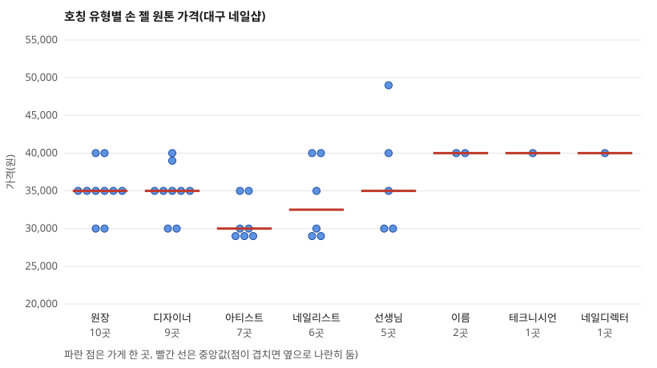

# 네일샵 시술자 호칭 유형과 손 젤 원톤 가격 수준의 관계: 대구 지역 탐색적 비교

**작성자**: 신영한
**작성일**: 2026-11-01

---

## 초록

같은 일을 하는데 시술자 호칭에 따라 가격 수준이 다른지 궁금했다.
대구 네일샵 58곳의 호칭(가게당 하나)과 손 젤 원톤 가격을 비교했다.
자료는 네이버 플레이스 공개 화면에서 모았고, 가격이 숫자인 41곳이 비교 대상이다.
"다르다"의 기준은 30명 설문(지인 5명, 커뮤니티 25명)의 중앙값 5,000원으로 정했다.
기준과 분석 방법은 가격을 보기 전에 문서로 확정했다.
호칭별 가격 중앙값은 원장·디자이너·선생님 35,000원, 네일리스트 32,500원, 아티스트 30,000원이다.
최고와 최저의 차이는 5,000원으로 기준과 같은 경계값이고 참고 검정은 유의하지 않았다(p=0.146).
지점 표기 가게를 빼거나 리뷰 수로 나누면 차이가 사라졌다.
설문의 호칭 순서는 응답자 사이에 일치했으나(W=0.80), 이유는 전문성보다 책임감 인상에 가까웠고 가격 순서와는 약하게 맞았다(0.34).
호칭 유형에 따라 가격이 다르다는 뚜렷한 증거는 확인되지 않았고, 인과는 말할 수 없다.

---

## 1. 서론

### 1.1 관심 분야

서비스와 기술로 돈을 버는 직업에서 사람을 부르는 호칭과 가격의 관계에 관심이 있다. 같은 일을 하는데 호칭 유형에 따라 가격 수준에 차이가 있는지 궁금했다. 원인으로는 높여 부르는 호칭을 주기적이고 지속적으로 듣는 영향과, 수입을 늘리려는 마음에서 전문성 있어 보이는 호칭을 스스로 붙이는 경우를 떠올렸고, 다른 원인일 가능성도 열어 두었다.

### 1.2 검토한 후보 주제와 접은 이유

최종 주제를 정하기까지 다음 세 가지를 검토하고 접었다. 앞의 둘은 주제 자체를 바꾸었다기보다 같은 주제 안에서 범위와 방법을 좁힌 선택이고, 셋째는 같은 자료로 답할 수 있는 다른 질문이다. 셋째는 가격 분석을 마친 뒤 논문을 쓰는 단계에서 추가로 검토했다.

1. **"가격 상승"과의 연관을 보는 연구.** 처음 문장이 이것이었다. 이 연구는 한 시점의 가격표를 모아 비교하므로 가격이 올랐는지는 볼 수 없다. 같은 가게의 가격을 시간을 두고 다시 확인하는 방법과 과거 가격을 찾는 방법은 연구자가 뒷받침 근거로 삼기 어렵다고 판단해 접었다. 그래서 "가격 수준의 차이"로 바꾸었다.
2. **직업 세 가지를 각각 끝까지 진행해 마지막에 비교하는 연구.** 처음에는 네일을 끝까지 하고 다른 직업도 같은 방식으로 반복하려 했다. 표본이 부족할까 걱정되어 세운 계획이었는데, 네일 하나만으로 표본이 충분해 이번에는 네일 하나만 다루었다. 시간이 되면 이후에 다른 직업도 확인할 예정이다.
3. **리뷰 수(인기)가 많은 가게일수록 가격이 높은가를 보는 연구.** 같은 자료로 답할 수 있는 질문이다. 인기는 호칭과 얽혀 있어(아티스트 가게의 리뷰 수 중앙값은 2,073, 원장 가게는 234) 호칭의 영향만 따로 볼 수 없다. 이 연구의 관심은 호칭이므로 리뷰 수는 질문으로 삼지 않고, 호칭 외에 맞추지 못한 조건으로 기록하고 민감도 확인에만 썼다.

### 1.3 연구 질문과 가설

처음의 문장은 "호칭에 따른 물가 상승과의 연관 관계"였다. 이 연구는 "상승"을 시간에 따른 가격 변화가 아니라 현재 가격 수준의 차이로 확인한다(1.4절).

- **연구 질문**: 같은 일을 하는데 호칭 유형에 따라 가격 수준에 차이가 있을까?
- **가설 A(1차)**: 네일샵에서 가게가 쓰는 호칭 유형에 따라 같은 시술(기준 메뉴)의 가격 수준이 다르다. 이 가설에서 호칭 유형은 가게마다 정한 호칭 하나이고, 가격 수준은 기준 메뉴의 가격이다. 호칭 유형이 가격에 영향을 줄 수 있다는 방향을 염두에 두었지만, 이 연구는 두 변수가 함께 달라지는지만 확인한다.
- **후속 가설 B**: 시술자를 더 높여 부르는 호칭을 쓰는 가게일수록 기준 메뉴의 가격 수준이 높다. A의 결과가 뚜렷할 때 세우기로 했고, 호칭의 높고 낮음은 가격과 무관하게 설문으로 정했다.
- **측정**: 호칭 유형은 가게의 소개문과 예약 화면에 적힌 시술자 표기에서 가게당 하나를 정한다(3.3절). 가격 수준은 가격 탭에 정상가로 적힌 손 젤 원톤 가격이다(3.4절). "다르다"의 기준은 설문 응답의 중앙값이다(3.6절).
- **가설이 틀렸을 때의 결과**: 5곳 이상인 호칭 유형 가운데 중앙값이 가장 높은 유형과 가장 낮은 유형의 차이가 기준 금액보다 작으면 가설 A는 맞지 않는 것으로 본다.
- **범위와 기간**: 대구 지역 네일샵, 2026년 11월 1일에 수집했다(계획한 수집 기간은 11월 1일부터 7일).

원인 후보로는 두 가지를 생각했다. 하나는 높여 부르는 호칭을 주기적이고 지속적으로 들은 사람이 스스로 가격을 높게 정하는 경우이고, 다른 하나는 수입을 늘리려는 마음에서 전문성 있어 보이는 호칭을 스스로 붙이고 가격도 높게 정하는 경우다. 두 번째 경우에는 호칭이 원인이 아니라 같은 뿌리에서 나온 결과다. 이 연구의 자료로는 둘을 가를 수 없다.

### 1.4 가설을 다듬은 과정

AI(Claude)와 대화하며 다음과 같이 가설을 다듬었다.

1. 처음 문장 "호칭에 따른 물가 상승과의 연관 관계"를 AI가 인건비 비중이 큰 서비스의 가격 문제로 이해했으나 연구자가 아니라고 바로잡았고, 같은 일을 하는 사람들의 호칭 유형과 가격의 관계로 다시 정했다.
2. 확인 방법으로 세 가지를 비교했다. (가) 현재 가격 수준을 호칭 유형별로 비교, (나) 같은 가게의 시간에 따른 가격 변화, (다) 과거 가격과 비교. 연구자가 (나)와 (다)는 뒷받침 근거가 되기 어렵다고 보아 (가)로 정하고 나머지는 꼭 필요할 때 후속으로 하기로 했다.
3. "가격 상승"을 "가격 수준의 차이"로 바꿨다. 한 시점의 비교로는 상승을 볼 수 없기 때문이다.
4. 호칭 외에 같게 맞춰야 할 조건(경력, 가게 규모, 위치, 재료비, 인기, 새로 연 가게)을 연구자가 제시했다. 모두 같게 맞출 수는 없어서 기록하고 한계에 적는 방식으로 정했다(3.5절).
5. AI가 제안하고 연구자가 받아들여, 가격을 비교하기 전에 가설 문구, 측정 방법, "다르다"의 기준, 분석 방법을 문서로 확정하기로 했다. 결과를 본 뒤 기준을 고르는 것을 막기 위해서다.

### 1.5 이 가설을 최종으로 고른 이유

- 같은 직업 안에서 호칭만 다른 가게를 비교할 수 있고(네일샵), 가격과 호칭이 공개된 화면에서 일주일 안에 모을 수 있다.
- 결과가 "차이 있음"으로 나와도, "차이 없음"으로 나와도 의미가 있다. 후자는 호칭이 가격과 무관할 수 있다는 정보를 준다.
- 인과를 주장하지 않고 두 변수가 함께 달라지는지를 묻는 탐색적 질문이라 자료로 답할 수 있다.

---

## 2. 선행 근거

### 2.1 참고한 문헌과 뒷받침하는 부분

| 문헌 | 이 연구의 어느 부분을 뒷받침하는가 |
|---|---|
| Greenberg & Ornstein (1983) | 높은 지위의 직함이 보수를 보완할 수 있다는 실험 근거. 직함과 보수가 연결될 수 있다는 점에서 호칭과 가격의 관계를 묻는 이유가 된다. 가격이 아니라 근로자의 형평 지각을 다뤘다 |
| Rao & Monroe (1989) | 소비자가 가격을 품질의 신호로 쓴다는 근거. 가격 수준이 서비스의 질에 대한 인식과 이어질 수 있음을 뒷받침한다 |
| Völckner & Hofmann (2007) | 가격이 품질 인식에 주는 효과가 1989~2006년 연구를 모은 분석에서 시간이 지나며 약해졌다는 근거. 호칭이 가격에 미치는 영향이 작거나 없을 수 있다는 결과의 해석에 쓴다. 다만 가격이 품질 인식에 주는 효과를 다룬 연구라 호칭과는 간접적인 근거다 |

### 2.2 이미 알려진 사실과 이 연구가 새로 주장하는 것

**이미 알려진 사실(문헌으로 확인한 부분)**
- 업무 성과로 얻은 높은 지위의 직함은 추가 업무에 대한 보상으로 작동할 수 있다. 얻지 않은 직함은 처음에는 성과를 올렸으나 이후 성과 하락과 과소 보상을 느끼는 것으로 이어졌다(Greenberg & Ornstein, 1983).
- 가격과 인식된 품질의 관계는 양(+)이고 통계적으로 유의하다고 보고되었다. 상점 이름이 품질 인식에 주는 효과는 작고 유의하지 않았다(Rao & Monroe, 1989).
- 가격이 품질 인식에 주는 효과는 1989~2006년 연구에서 시간이 지나며 약해졌고, 서비스에서는 더 약했다(Völckner & Hofmann, 2007).

**이 연구가 새로 주장하는 것**
- 대구 네일샵 58곳에서 시술자 호칭 유형별로 손 젤 원톤 가격 수준을 비교했을 때 뚜렷한 차이가 확인되지 않았다는 탐색적 관찰이다. 호칭과 서비스 가격의 관계를 직접 다룬 연구는 영어와 한국어 검색으로 찾지 못했다(검색 범위가 제한적이다).

### 2.3 실험이나 데이터로 검증된 연구

Greenberg & Ornstein (1983)은 교정 업무를 시키는 실험이다. Rao & Monroe (1989)와 Völckner & Hofmann (2007)은 여러 선행 연구를 모은 메타분석으로, 실험과 관찰 자료를 통합한 연구다.

### 2.4 목록에서 뺀 문헌과 이유

| 뺀 문헌 | 이유 |
|---|---|
| Sirigiri & Zunino 워킹페이퍼(스타트업 직함 연구) | 서지와 초록을 확인하지 못함 |
| Wunderlich 박사과정 발표(직함 인플레이션) | 발표 소개글만 있고 논문을 확인하지 못함 |
| 네일 서비스 만족도 학위논문, 네일 직업 분류 논문 | 호칭이나 가격 변수를 다루지 않고 서지를 확인하지 못함 |

### 2.5 출처를 확인한 방법

세 편의 서지(저자, 연도, 학술지, 권호, 쪽수)는 Crossref 등록 정보에서 확인했다. 내용은 다음 수준까지만 확인했다.
- 세 편 모두 연구자가 시크릿 창에서 연 출판사 페이지(APA PsycNet, SAGE, Springer Link)의 **초록 원문**을 확인했다. 세 링크는 로그인이나 인증 없이 열렸다.
- 확인한 것은 초록까지이고 **본문은 읽지 못했다.** 초록에 없는 수치와 효과 크기는 쓰지 않았다.

---

## 3. 방법

### 3.1 설계 요약

| 항목 | 내용 |
|---|---|
| 직업 | 네일샵 시술(손 젤 원톤을 기준 메뉴로 하고 발 젤 원톤을 보조 결과로 봄) |
| 지역 | 대구 |
| 바꾼(관찰한) 조건 | 가게의 호칭 유형. 조작한 것이 아니라 가게가 이미 쓰는 호칭을 관찰했다 |
| 고정한 조건 | 직업(네일), 지역(대구), 비교 메뉴, 수집 기간(일주일 이내), 가격은 정상가만 사용 |
| 기록만 하고 맞추지 못한 조건 | 구·동, 가게 전체 리뷰 수(인기 대용), 경력(적힌 경우만), 새로 연 가게(오픈 표시가 있는 곳은 제외), 지점 표기 |
| 가정한 조건 | 가게 규모와 재료비는 가격에 큰 영향이 없다고 가정(확인하지 못함) |
| 표본 | 기록한 가게 82곳 → 포함 58곳 → 손 젤 원톤 가격 비교 41곳(발 젤 34곳). 설문 응답자 30명 |
| 반복 | 가게마다 한 번 관찰(반복 측정 없음). 설문은 응답자마다 한 번 |
| 측정한 값 | 가게의 호칭 유형(범주), 손 젤 원톤 가격(원), 설문의 호칭 전문성 순서와 "확실히 다르다"고 느끼는 가격 차이(원) |

### 3.2 자료를 모은 방법과 출처

- **출처**: 네이버 플레이스에 가게가 직접 등록한 공개 화면(가격 탭, 예약 탭, 홈 탭). 가게마다 세 장씩 연구자가 화면을 캡처해 제공했고, AI가 그 이미지를 읽어 CSV로 옮겼다. 수집일은 2026년 11월 1일이다.
- **원본 이미지**: 얼굴과 전화번호 같은 개인 식별 정보가 있어 제출물에 넣지 않았고 폐기했다. 그래서 값의 근거를 CSV의 비고에 적었다. 따라서 이미지로 다시 확인할 수 없다.
- **가게 이름**: 중복 확인을 위해 제출물에 넣지 않는 별도 파일에만 두었고 원자료 CSV에는 가게 번호만 적었다. 같은 가게가 두 번 온 경우는 한 번만 기록했다(중복 3건).
- **기록하지 않은 것**: 행사가와 이벤트가, 속눈썹과 왁싱과 메이크업 메뉴, 전화번호와 주소, 시술자 이름.
- **제출 전에 가린 것**: 처음 기록할 때 가게 비고 17곳과 메뉴 이름 3줄에 시술자 이름과 가게의 지점 이름이 그대로 옮겨져 있었다. 제출 전에 점검에서 발견해 "○○"로 가렸다. 호칭, 가격, 숫자는 바꾸지 않았고, 가린 뒤 분석을 다시 실행해 결과 파일이 같음을 확인했다.

### 3.3 표본 선정과 호칭 유형

기록한 82곳 가운데 다음 24곳을 제외해 58곳을 표본으로 했다.

| 제외 이유 | 곳수 |
|---|---|
| 예약 탭에 상품 이름만 있어 시술자 호칭이 보이지 않음 | 12 |
| 예약 탭이 없어 호칭을 알 수 없음 | 7 |
| 소식 제목이나 쿠폰에 "open", "오픈" 표시가 있음 | 3 |
| 호칭이 보이지 않음(기타) | 1 |
| 가격 탭과 홈 탭이 없음 | 1 |

호칭은 예약 화면의 시술자 표기와 소개문, 상품 설명에서 찾았고 가게당 하나만 정했다.
- 원장, 부원장, 실장이 아닌 호칭이 하나면 그것을 썼다. 없으면 원장이나 실장을 썼다.
- 원장류가 아닌 호칭이 둘 이상이면 연구자가 하나를 정하거나 제외했다.
- 시술자가 이름으로만 적혀 있으면 호칭을 "이름"으로 보았다.
- "쌤"과 "선생님", "네일아티스트"와 "아티스트"는 같은 호칭으로 보았다.
- 58곳 가운데 35곳은 위 규칙으로 정했고 23곳은 연구자가 직접 정했다.

결과적으로 호칭 유형은 디자이너 15곳, 원장 11곳, 네일리스트 10곳, 선생님 9곳, 아티스트 9곳, 이름 2곳, 테크니시언 1곳, 네일디렉터 1곳이다. 유형을 합치거나 "기타"로 묶지 않고 단어 그대로 두었다.

### 3.4 가격 변수

- **기준 메뉴**: 가격이 숫자로 적힌 메뉴 가운데 가장 많은 가게에 있던 "손 젤 원톤"이다. 원톤, 젤원톤, 원컬러, 원칼라, 풀컬러를 같은 메뉴로 묶었고 띄어쓰기는 무시했다. "컬러"만 들어간 메뉴(예: 케어+컬러젤)는 묶지 않았다. 이 선택은 가격이 아니라 메뉴 이름의 횟수로만 했다.
- 범위로 적힌 가격은 하한을, 시술자별 가격이 여럿이면 낮은 값을 썼다. "상담"으로만 적힌 가게는 가격 비교에서 뺐다.
- 가격 화면의 표시는 비회원가 기준이다.

### 3.5 호칭 외 조건

호칭 외 조건을 모두 같게 맞추기는 어려워 가능한 것은 기록하고 호칭 유형별 분포를 나란히 보았다(4.4절). 규모와 재료비는 가격에 큰 영향이 없다고 가정했고 확인하지 못했다.

### 3.6 설문

설문 대상은 네일샵 시술을 받아 본 성인으로 정했다. 응답자는 30명이고 지인 5명과 커뮤니티 25명이다. 지인에게는 연락하거나 구두로 물었고, 커뮤니티에서는 설문을 게시해 답변을 받았다. 이름과 연락처는 받지 않고 응답 번호로만 기록했다. 설문은 다음 문항으로 구성했고, 가게 이름과 가격 결과와 가설은 알리지 않도록 설계했다.

1. **호칭 순서**: 호칭 7개(디자이너, 원장, 네일리스트, 선생님, 아티스트, 테크니시언, 이름)를 전문성이 높게 느껴지는 순서로 말하게 했다. 단어가 주는 첫인상이고 실제 실력과 무관하다고 먼저 안내했다.
2. **가격**: (a) 평소 손 젤 원톤에 내는 가격, (b) 같은 시술에서 그 가격보다 얼마 이상 차이 나면 "확실히 다르다"고 느끼는지.

(b)의 응답 중앙값을 가설 A의 판정 기준으로 썼다. 호칭 질문을 가격 질문보다 먼저 물어 가격 이야기가 호칭 인상에 영향을 주지 않게 했다. 원래 설계는 호칭 5개였고 실제 설문은 연구자가 7개로 진행했다.

응답자가 순위를 매긴 이유는 간단한 답으로 들었고, 연구자가 그 답들을 AI로 분석해 요약했다(4.2절). 응답별 이유의 원문은 제출한 원자료에 들어 있지 않다.

시작할 때 연구 목적과 익명 기록을 안내했다. 응답자의 성별과 연령대 같은 특성은 묻지 않았고, 네일샵 이용 경험을 어떻게 확인했는지는 기록하지 않았다. 커뮤니티에 게시한 설문은 문항 순서와 안내 문장이 모든 응답자에게 같은 조건으로 전달되었는지 확인할 수 없다. 응답별로 지인과 커뮤니티를 구분하는 표시는 남기지 않았다.

### 3.7 분석

미리 확정한 분석(가격을 보기 전에 문서에 적음)은 다음과 같다.
- 호칭 유형별 곳수, 중앙값, 사분위, 최소, 최대와 점 그림.
- 판정: 5곳 이상인 유형들 가운데 중앙값이 가장 높은 유형과 가장 낮은 유형의 차이가 기준 금액 이상이면 "차이 있음", 미만이면 "차이 없음".
- 크러스컬–월리스 검정(5곳 이상 유형만, 유의수준 0.05)을 참고로 덧붙이고 사후 쌍비교는 하지 않았다.
- 민감도 확인: 지점 표기가 있는 가게를 뺀 비교, 리뷰 수가 포함 가게 전체 중앙값(651.5) 이하인 가게와 초과인 가게로 나눈 비교.
- 설문 순위의 평균과 켄달의 W(효과 크기로만 보고), 가격 중앙값 순서와의 스피어만 순위 상관(유형이 5개 이하라 검정하지 않음).
- 발 젤 원톤은 같은 방식의 보조 결과다.

분석은 `scripts/analyze.py`(파이썬 표준 라이브러리만 사용)로 실행했다. 가격 분석은 설문 응답이 20건 이상일 때만 실행되게 막아 두어, 설문 전에 가격 결과를 열지 않았다.

### 3.8 설계를 바꾼 기록

가격 분석을 실행한 뒤에 바꾼 설계나 분석 방법은 없다(실행 뒤에는 그림을 만드는 기능을 스크립트에 추가했고, 표의 마지막 줄처럼 이름을 가렸을 뿐이며 분석 결과는 바뀌지 않았다). 바꾼 기록은 다음과 같다.

| 바꾼 것 | 이유 |
|---|---|
| 이전에 모은 대구 네일 자료를 모두 폐기하고 처음부터 다시 시작 | 연구자 결정. 설계를 바꾼 것이 아니라 처음으로 되돌렸다 |
| 자료 출처를 공식 기관과 학술 출처로 한정했다가 가게의 공개 페이지를 읽는 예외를 둠 | 가격과 호칭은 기관 자료에 없고 가게 페이지에만 있음 |
| 당근 가게 프로필 47곳을 AI가 직접 읽어 시험했으나 분석 자료로는 쓰지 않음 | 소개문에 호칭이 적힌 곳이 약 9%로 적어 표본이 부족했고, 대신 연구자가 네이버 플레이스 화면을 제공하는 방식으로 바꿈 |
| 호칭 규칙: 원장만 있는 가게를 제외하려던 것을 포함하도록 바꿈. 다른 호칭이 둘 이상이면 자동 제외하던 것을 연구자가 정하도록 바꿈. 상품 이름만 있으면 제외, 이름으로만 적힌 시술자는 "이름"으로 세기로 추가 | 표본이 너무 적어짐 |
| 소식 제목의 "open"과 쿠폰 이미지의 "OPEN EVENT"도 오픈 표시로 보기로 함 | 새 가게의 오픈 이벤트 가격이 가격 수준을 왜곡할 수 있음 |
| 시술자별 가격이 여럿이면 낮은 값을 쓰기로 함 | 가게 단위 가격으로 맞추기 위함 |
| 비교 메뉴 묶음에서 띄어쓰기를 무시하도록 정정(손 젤 원톤류 40곳 중 39곳을 42곳 중 41곳으로) | "원 컬러"로 적은 2곳을 놓쳤음. 가격을 보기 전에 바로잡음 |
| 설문의 호칭을 5개에서 7개로 늘려 진행 | 연구자가 설문에서 두 호칭을 더 물음 |
| 설문 방식을 구두에서 지인 5명은 연락·구두, 커뮤니티 25명은 게시한 설문으로 넓힘 | 연구자가 응답자 30명을 받는 방식으로 진행함(구체적인 이유는 기록하지 않음) |
| 문헌 세 편의 초록 원문을 제출 전에 출판사 페이지로 직접 확인하고 문장을 초록에 맞춤(Rao & Monroe의 효과 크기 표현 삭제, Greenberg & Ornstein의 조건 보완) | 이전에는 초록 원문을 열지 못해 2차 요약으로 확인했었음 |
| 제출 전에 원자료의 비고 17칸과 메뉴 이름 3칸에서 시술자 이름과 지점 이름을 "○○"로 가림(분석 뒤에 한 일이지만 분석 결과는 바뀌지 않음) | 시술자 이름과 가게를 알아볼 수 있는 정보를 제출물에 넣지 않기 위함 |

---

## 4. 결과

### 4.1 표본

| 단계 | 곳수 |
|---|---|
| 기록한 가게 | 82 |
| 호칭 규칙을 통과한 표본(포함) | 58 |
| 손 젤 원톤 가격이 숫자인 가게(비교 대상) | 41 |
| 발 젤 원톤 가격이 숫자인 가게(보조) | 34 |
| 설문 응답(유효) | 30 |

### 4.2 설문 결과

| 항목 | 결과 |
|---|---|
| 호칭 전문성 순서(평균 순위가 작을수록 전문성이 높다고 느낌) | 원장 1.87, 디자이너 2.53, 네일리스트 2.80, 아티스트 2.87, 선생님 5.30, 테크니시언 5.77, 이름 6.87 |
| 응답자 일치도 켄달의 W | 0.80 |
| "확실히 다르다"고 느끼는 가격 차이 | 중앙값 5,000원(5,000원 18명, 10,000원 12명) |
| 평소 손 젤 원톤 가격 | 중앙값 35,000원(28,000~50,000원) |

**순위를 매긴 이유(질적 요약).** 연구자가 응답자의 간단한 이유를 AI로 분석해 정리한 요약이다. 응답 수를 센 값이 아니라 경향이며, 응답별 원문은 제출하지 않았다.
- 원장을 높게 둔 응답에서는 전문 기술보다 **책임자라는 인상**이 이유로 많았다. 선생님보다 원장을 더 높게 보았다.
- 디자이너와 아티스트를 높게 둔 응답에서는 **디자인 역량이나 창의성**(결과물이 일반적이지 않기를 바라는 마음)이 이유였다.
- 네일리스트는 네일 분야에 특화된 표현이라는 점이 고려되어 순위가 다양한 위치에 흩어졌다.
- 선생님, 테크니시언, 이름의 순위는 응답자마다 달랐다.

이 요약을 보면 질문은 "전문성이 높게 느껴지는 순서"였지만 응답자들의 판단 기준에는 책임감, 창의성 같은 다른 인상이 섞여 있었다.

### 4.3 호칭 유형별 가격(가설 A의 결과)

**표 1. 손 젤 원톤 가격(원), 비교 41곳**

| 호칭 유형 | 곳수 | 중앙값 | 사분위(25~75%) | 최소 | 최대 |
|---|---|---|---|---|---|
| 원장 | 10 | 35,000 | 35,000~35,000 | 30,000 | 40,000 |
| 디자이너 | 9 | 35,000 | 35,000~35,000 | 30,000 | 40,000 |
| 아티스트 | 7 | 30,000 | 29,000~32,500 | 29,000 | 35,000 |
| 네일리스트 | 6 | 32,500 | 29,250~38,750 | 29,000 | 40,000 |
| 선생님 | 5 | 35,000 | 30,000~40,000 | 30,000 | 49,000 |
| 이름 | 2 | 40,000 | 40,000~40,000 | 40,000 | 40,000 |
| 테크니시언 | 1 | 40,000 | - | 40,000 | 40,000 |
| 네일디렉터 | 1 | 40,000 | - | 40,000 | 40,000 |

**그림 1.** 호칭 유형별 손 젤 원톤 가격. 점은 가게 한 곳, 빨간 선은 중앙값이다.

- 5곳 이상인 유형은 원장, 디자이너, 아티스트, 네일리스트, 선생님이다.
- 중앙값이 가장 높은 유형(원장, 디자이너, 선생님이 같은 35,000원)과 가장 낮은 유형(아티스트 30,000원)의 차이는 **5,000원**이고 기준(5,000원)과 같다. 미리 정한 판정은 **"차이 있음"**이다.
- 참고 검정: 크러스컬–월리스 H=6.82, p=0.146(유형 5개, 가게 37곳). 효과 크기 ε²=(H−k+1)/(n−k)는 약 0.09이다(이 공식은 문헌으로 확인하지 못했다).
- 설문 전문성 순서와 가격 중앙값 순서의 스피어만 상관은 0.34(유형 5개, 검정하지 않음).

**표 2. 민감도 확인(손 젤 원톤)**

| 확인 | 비교 가게 | 5곳 이상 유형 | 판정 |
|---|---|---|---|
| 지점 표기가 있는 가게를 뺌 | 28 | 원장, 네일리스트, 디자이너(중앙값 모두 35,000원) | 차이 없음(차이 0원, H=0.21, p=0.899) |
| 리뷰 수 651.5 이하 | 22 | 원장, 디자이너(중앙값 모두 35,000원) | 차이 없음(차이 0원) |
| 리뷰 수 651.5 초과 | 19 | 아티스트 1개 유형만 | 판정 불가 |

**표 3. 발 젤 원톤 가격(원), 보조 결과, 비교 34곳**

| 호칭 유형 | 곳수 | 중앙값 | 최소 | 최대 |
|---|---|---|---|---|
| 원장 | 8 | 45,000 | 40,000 | 45,000 |
| 디자이너 | 7 | 45,000 | 40,000 | 50,000 |
| 아티스트 | 6 | 40,000 | 39,000 | 45,000 |
| 선생님 | 5 | 45,000 | 40,000 | 58,000 |
| 네일리스트 | 4 | 40,000 | 39,000 | 45,000 |
| 이름 | 2 | 50,000 | 50,000 | 50,000 |
| 테크니시언, 네일디렉터 | 각 1 | 50,000 | 50,000 | 50,000 |

발 젤도 같은 모양이다. 5곳 이상인 유형(원장, 디자이너, 아티스트, 선생님) 가운데 가장 높은 쪽(45,000원)과 가장 낮은 쪽(아티스트 40,000원)의 차이는 5,000원으로 기준과 같아 판정은 "차이 있음"이었고, 참고 검정은 유의하지 않았다(H=5.84, p=0.120, 유형 4개). 지점 표기 가게를 빼면 5곳 이상인 유형이 1개뿐이라 판정할 수 없었다.

### 4.4 호칭 외 조건의 분포

**표 4. 호칭 유형별 분포(포함 58곳)**

| 호칭 유형 | 포함 | 구 분포 | 리뷰 수 중앙값 | 지점 표기 |
|---|---|---|---|---|
| 디자이너 | 15 | 중구 8, 수성구 4, 남구 1, 달서구 1, 북구 1 | 551 | 5 |
| 원장 | 11 | 중구 3, 수성구 2, 동구 2, 서구 1, 남구 1, 달성군 1, 달서구 1 | 234 | 2 |
| 네일리스트 | 10 | 달서구 4, 중구 3, 동구 2, 서구 1 | 799.5 | 2 |
| 선생님 | 9 | 중구 6, 남구 1, 동구 1, 수성구 1 | 622 | 5 |
| 아티스트 | 9 | 달서구 3, 수성구 2, 중구 1, 남구 1, 동구 1, 북구 1 | 2,073 | 5 |
| 이름 | 2 | 달서구 1, 중구 1 | 808.5 | 0 |
| 테크니시언 | 1 | 중구 1 | 1,413 | 0 |
| 네일디렉터 | 1 | 남구 1 | 1,081 | 0 |

경력이 적힌 가게는 58곳 중 5곳뿐이라 통제에 쓸 수 없었다.

### 4.5 가설대로 나온 부분과 다르게 나온 부분

**가설 A에 부합한 부분**
- 미리 정한 판정 규칙으로는 "차이 있음"(최고와 최저 유형의 중앙값 차이 5,000원이 기준 5,000원 이상).

**가설 A와 다르거나 약하게 나온 부분(모두 기록)**
1. 차이가 기준과 정확히 같은 경계값이다.
2. 참고 검정이 유의하지 않다(p=0.146, 발 젤 p=0.120).
3. 지점 표기 가게를 빼면 "차이 없음"이 된다(표 2).
4. 리뷰 수가 중앙값 이하인 가게만 보면 "차이 없음"이고, 초과인 가게는 유형이 부족해 판정할 수 없다(표 2).
5. 설문의 전문성 순서와 가격 순서가 약하게만 맞는다(스피어만 0.34). 설문에서 5위인 선생님이 가격 중앙값은 공동 최상위(35,000원)이고, 4위인 아티스트가 가장 낮다(30,000원).
6. 전문성이 낮다고 응답된 호칭(평균 순위 이름 6.87, 테크니시언 5.77)과 설문에 없던 네일디렉터가 가장 높은 중앙값(40,000원)을 보였으나 곳수가 1~2곳이라 해석하지 않는다. 이는 후속 가설 B의 방향(더 높여 부를수록 비싸다)과 반대다.
7. 발 젤도 같은 경계값 패턴이고 판정 가능한 유형 수가 더 적다.

### 4.6 가설의 수정 여부

가설 A의 문구는 분석 전과 후가 같다. 가설 단계에서 문장을 고친 것은 1.4절에 적은 대로 "물가 상승과의 연관 관계"를 "가격 수준의 차이"로 바꾼 것뿐이고, 이는 가격을 보기 전에 이루어졌다. 후속 가설 B는 결과가 뚜렷하지 않아 세우지 않았다.

---

## 5. 논의

### 5.1 결과 판단

미리 정한 판정 규칙으로는 가설 A가 "차이 있음"이지만, 차이가 기준과 같은 경계값이고 참고 검정이 유의하지 않으며 지점 표기 가게를 빼거나 리뷰 수로 나누면 차이가 사라진다. 그래서 **호칭 유형에 따라 가격 수준이 다르다는 뚜렷한 증거는 이 자료에서 확인되지 않았다고 판단한다.** 근거가 되는 값은 표 1(중앙값 30,000~35,000원, 최고와 최저의 차이 5,000원), 표 2(민감도에서 차이 0원), 4.3절의 검정 결과(p=0.146)와 스피어만 상관 0.34이다.

### 5.2 다르게 나온 이유로 검토한 가능성

1. **시장에서 정해진 표준 가격**: 손 젤 원톤에서 세 유형의 중앙값이 같은 35,000원이다. 호칭과 상관없이 비슷한 가격을 받는 직업일 수 있다. 이 연구로는 확인하지 못했다.
2. **작은 표본**: 유형당 5~10곳이라 중간 크기의 차이가 있어도 잡히지 않을 수 있다. "차이가 없다"고 단정할 수 없다.
3. **호칭 외 요인**: 인기(리뷰 수), 위치, 지점 소속이 호칭 유형별로 다르게 분포한다(표 4). 아티스트 가게는 리뷰 수 중앙값이 2,073으로 가장 높고 원장 가게는 234로 낮아, 호칭과 인기가 얽혀 있다.
4. **호칭 단어와 실제 숙련도의 불일치**: 호칭이 실제 경력이나 실력과 일치한다는 보장이 없다.
5. **가격 단위가 거칠다**: 가격이 5,000원 단위에 몰려 있어 기준 금액(5,000원)이 곧 한 칸이고 판정이 거칠게 나뉜다.
6. **설문의 순서가 전문성이 아니라 책임감과 창의성 인상을 반영했을 가능성**: 4.2절의 이유 요약에 따르면 원장은 책임자 인상, 디자이너와 아티스트는 창의성 인상으로 높게 평가되었다. 그렇다면 설문 순서와 가격 순서가 약하게만 맞은 것(스피어만 0.34)은 순서가 가격과 관련된 "전문성"을 재지 못했기 때문일 수 있다. 또 원장은 가게를 운영하는 사람인 경우가 많아 가격을 정하는 권한과 연결될 수 있다는 추측이 가능하지만, 이 연구에서는 확인하지 않았다.

### 5.3 결론

대구 네일샵 58곳에서 시술자 호칭 유형별로 손 젤 원톤 가격 수준을 비교한 결과, 중앙값은 30,000원에서 35,000원 사이였고 가장 높은 유형과 낮은 유형의 차이는 5,000원으로 미리 정한 기준(응답자 30명의 중앙값)과 같았다. 이 판정은 경계값이었고 지점 표기 가게를 빼거나 리뷰 수로 나누면 사라졌으며 참고 검정도 유의하지 않았다. 설문 응답자들은 호칭의 전문성 순서에 크게 의견이 일치했지만(켄달의 W=0.80) 그 순서는 가격 순서와 약하게만 맞았다. 따라서 호칭 유형에 따라 가격 수준이 다르다는 뚜렷한 증거는 확인되지 않았다. 이 결과는 호칭이 가격을 정한다는 인과를 말하지 않으며, 호칭과 가격이 무관하다는 것을 입증하지도 않는다. 후속 연구로는 가격이 덜 표준화된 직업이나 표본을 더 크게 모은 비교를 생각할 수 있다.

### 5.4 한계

이 연구로 말할 수 없는 것은 다음과 같다.

1. **인과**: 호칭이 가격을 일으키는지, 가격을 높게 받는 가게가 호칭을 높이는지를 가르지 못한다.
2. **일반화**: 대구 네일샵 중 네이버 플레이스에 시술자 표기가 공개된 곳에 한정된다. 다른 지역과 직업, 표기를 하지 않은 가게에는 적용할 수 없다.
3. **표본 크기**: 유형당 1~10곳이다. 이름, 테크니시언, 네일디렉터는 해석할 수 없다. 설문 30명이라는 숫자는 문헌에서 근거를 찾지 못한 연구자가 정한 값이다.
4. **설문의 대표성과 조건**: 지인 5명과 커뮤니티 25명의 편의 표집이라 일반인의 인상이라고 할 수 없다. 응답자 특성(성별, 연령대)을 묻지 않았고, 커뮤니티에 게시한 설문은 같은 조건으로 응답했는지(문항 순서, 중복 응답, 이용 경험 확인) 통제하지 못했다. 또 설문은 호칭에 대한 인상을 물었을 뿐 실제 가격 결정과 무관하다.
5. **맞추지 못한 조건**: 경력(5곳만 기재), 가게 규모와 재료비(가정), 위치(구 단위 기록, 중구 23곳으로 쏠림), 인기(호칭별 차이 큼), 지점 소속, 새로 연 가게(오픈 표시가 없는 새 가게는 걸러내지 못함).
6. **가격 자료**: 가게가 올린 정상가이고 비회원가 기준이다. 실제로 결제한 금액이 아니다. 같은 이름의 메뉴라도 포함 내역(케어 포함 여부 등)이 다를 수 있다.
7. **호칭 판단**: 58곳 중 23곳은 연구자가 직접 정했다. 판단이 달라지면 유형이 달라질 수 있다.
8. **재확인 불가**: 원본 이미지를 폐기해 화면으로 다시 확인할 수 없다.
9. **통계**: 표본이 작아 중앙값과 순위 상관 위주로 보았고 검정의 힘이 낮다. 문헌은 초록 원문까지만 확인했고 본문은 읽지 못했다(2.5절).
10. **설문이 잰 것**: 설문은 "전문성" 순서를 물었지만 응답자들은 책임감과 창의성 같은 인상으로 답한 경향이 있었다(4.2절). 이유는 연구자가 AI로 요약한 것이라 응답 수나 비율을 말할 수 없고, 원문을 제출하지 않았다.

---

## 참고문헌

Greenberg, J., & Ornstein, S. (1983). High status job title compensation for underpayment: A test of equity theory. *Journal of Applied Psychology, 68*(2), 285–297. https://doi.org/10.1037/0021-9010.68.2.285

Rao, A. R., & Monroe, K. B. (1989). The effect of price, brand name, and store name on buyers' perceptions of product quality: An integrative review. *Journal of Marketing Research, 26*(3), 351–357. https://doi.org/10.1177/002224378902600309

Völckner, F., & Hofmann, J. (2007). The price-perceived quality relationship: A meta-analytic review and assessment of its determinants. *Marketing Letters, 18*(3), 181–196. https://doi.org/10.1007/s11002-007-9013-2

---

## 재현 방법

**준비**: 파이썬 3.9 이상. 외부 패키지와 인터넷 연결은 필요 없다.

**자료**(`data/raw/`)
- `nail_shops.csv`: 가게 82곳(가게 번호, 구, 리뷰 수, 호칭 후보와 채택 호칭, 포함 여부와 제외 이유, 수집일, 비고)
- `nail_menus.csv`: 가게별 메뉴와 가격 705줄
- `survey_responses.csv`: 설문 응답 30건(호칭 순위 7개, 평소 가격, "확실히 다르다"고 느끼는 차이)

가게 이름 목록은 개인과 가게를 알아볼 수 있어 제출물에 포함하지 않았다.

**실행**(프로젝트 폴더에서)
1. `python3 scripts/analyze.py check`: 자료 점검. 가게 82곳(포함 58), 메뉴 705줄, 가격이 숫자가 아닌 줄 0이 나오는지 확인한다.
2. `python3 scripts/analyze.py survey`: 설문 요약. 유효 30건, 기준 금액 5000원, W 0.802.
3. `python3 scripts/analyze.py prices`: 표 1~3과 민감도 결과. 결과 파일은 `data/processed/`에 저장된다.
4. `python3 scripts/analyze.py figure`: 그림 1(`paper/figures/`).

**짧은 확인**: 위 1번 결과의 포함 58곳과 손 젤 원톤 숫자 가격 41곳(호칭별 합계), 3번 결과의 "판정(기준 5000원): 차이 있음"과 "크러스컬–월리스 H=6.819, p=0.146"이 본문과 같으면 결과를 다시 확인한 것이다.
